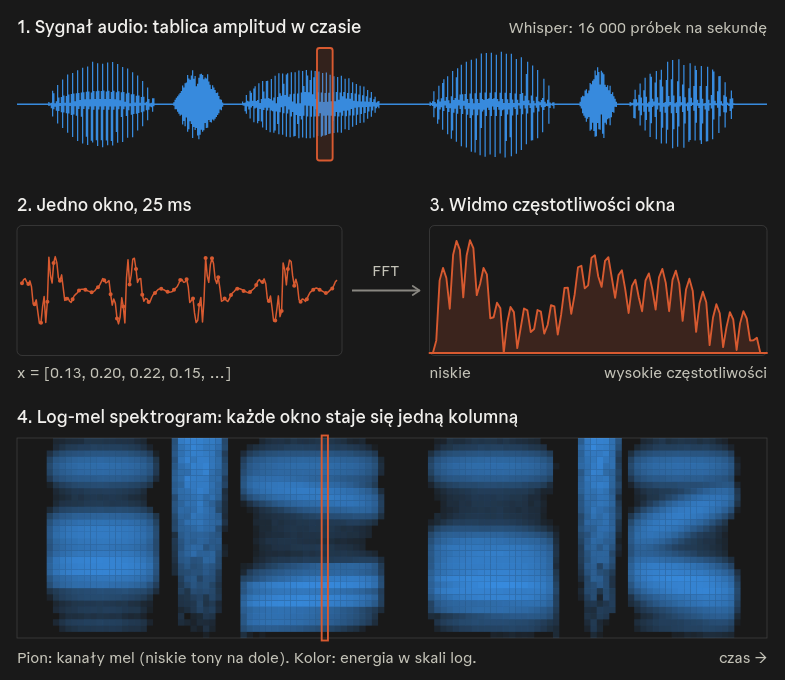
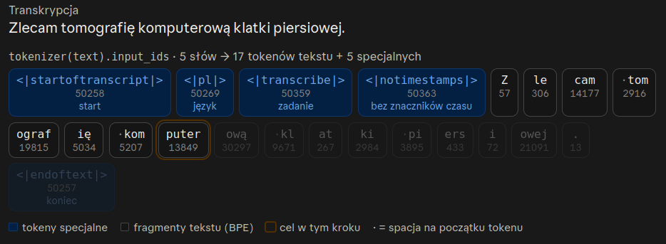
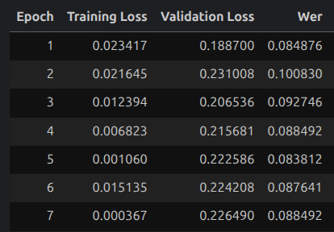
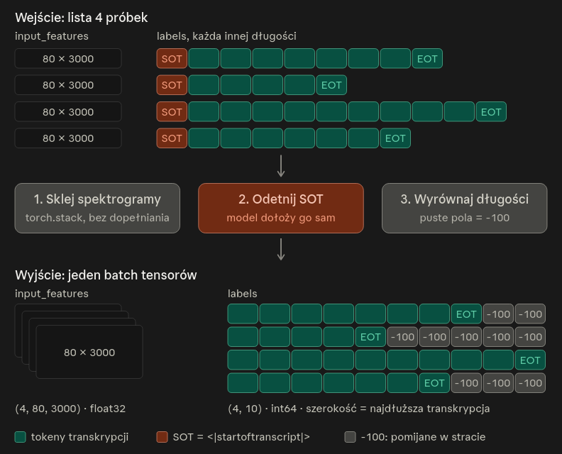
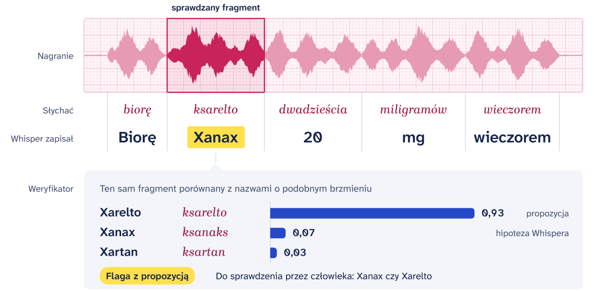

# Fine-tuning Whisper for Polish industry-specific conversations: summary

## In short

A general speech-to-text model makes most of its mistakes on what matters most in an industry: terms, names,
abbreviations and numbers with units. 
This project covers preparing training data, fine-tuning Whisper for a chosen
industry, and evaluating the quality of the training.

The examples in the code and documentation come from the medical industry.

## Various decisions

1. To be able to prepare recordings with Chatterbox, voices had to be prepared for the speakers, so as to have a large pool of different
voices, which keeps the model from fitting to just one voice during training. For this purpose, roughly 8–12 second voice samples
were prepared from Mozilla Common Voice.
2. The conversations were prepared by a language model. Then, using a text-to-speech model, recordings
of each utterance in the conversation were prepared. As well as one long recording made up of all the fragments.
3. Preparing the recordings in the right format for training the model. One of the elements was that the sampling rate
of the recordings was converted to 16 kHz (the Whisper model was trained on recordings with this sampling rate).

4. Voices are split into training, test and validation sets. So that there is certainty that the same person does not voice
conversations in more than one of these three sets.
5. The format of the prepared conversations is a .json file containing information such as: a list of industry terms,
and the successive exchanges between the people talking, an identifier.

6. One of the more important elements of using audio during model training is converting
the recording into a spectrogram. To do this, we split the recording into fragments and turn the amplitude over time into a chart showing how much
of which frequencies there is in that fragment of the recording. Each such fragment is ultimately represented as
one column of values in the spectrogram.

The text data of the audio recordings used in training also has to be prepared to be fed
into the model. So we use the tokenizer to create a numerical representation of these transcriptions. In them we can see
specific special tokens such as <|startoftranscript|>, <|pl|>, <|transcribe|>, <|notimestamps|>

7. Training the model. In this case, while I was training the model, I displayed how the
training loss and validation loss changed. The metric is primarily WER, i.e. the differences between the text generated
by WHISPER and the original text.

Training on batches involves combining recordings into batches of tensors, both for the audio
and their transcriptions. In the case of transcriptions, since some utterances are longer than others, the numerical
representations of shorter utterances must be padded with the value "-100". In the case of audio this problem is solved
by adding silence to the recording.

# Other information:
+ at the moment, training and training validation have been based only on synthetic data
+ I have several audio-text datasets that will potentially serve as real data.
+ Model tests must be based on both general Polish-language data and industry-specific data. This way
it will be possible to track whether fine-tuning has not made the model worse outside the industry.

- Model: whisper-small, full fine-tuning (I plan to test LoRA).

# Idea for using an embedding model (audio-text):
This model will be prepared to help choose the right word from among several suggestions.
When a word is spoken and is potentially an industry term, we take
the audio recording of that word, create an embedding from it and search for the most similar embeddings
of industry terms in a vector database. Thanks to this, e.g. when hovering over an industry word, a window can appear
with the industry terms that sound most similar to the one spoken. This makes it
possible to quickly correct the word with one click.

