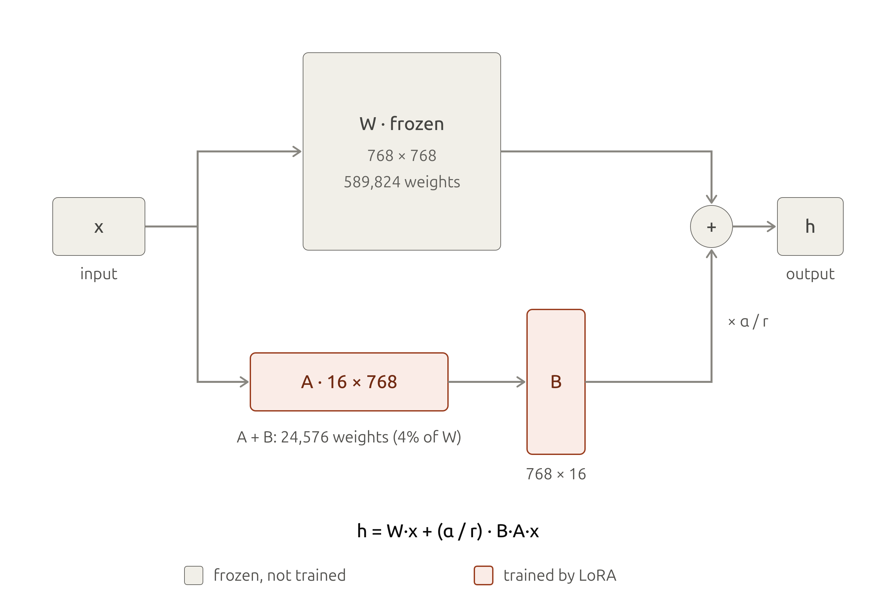
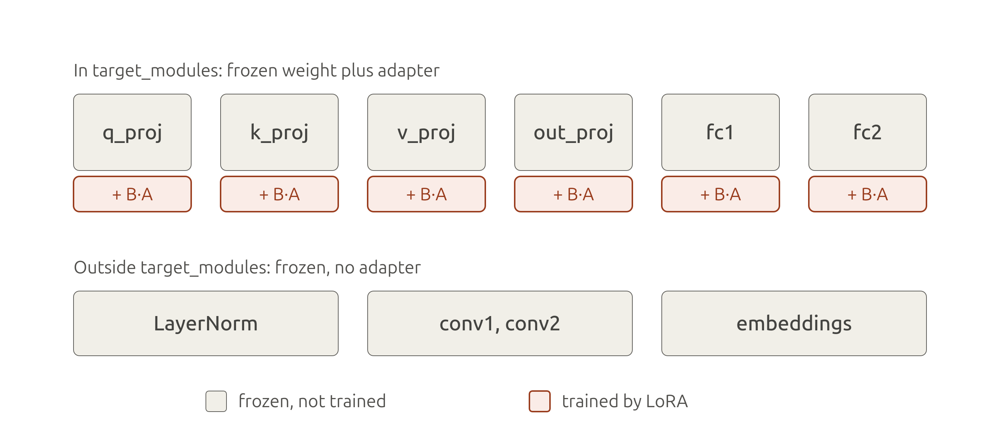
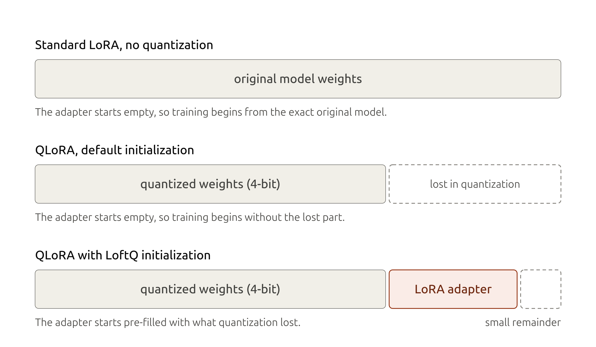
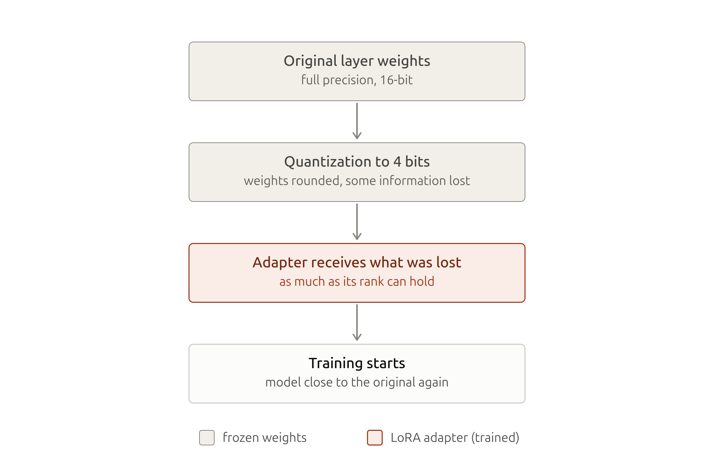

# LoRA in fine-tuning of models

LoRA (Low-Rank Adaptation) is one of the most popular methods of parameter-efficient fine-tuning
(PEFT). It can be applied to any model based on neural networks.

A good library for parameter-efficient fine-tuning is `peft`:

```bash
pip install peft
```

## How LoRA works

### Inside one layer

The picture shows how the weights of one layer are split: one part is the frozen weights
of the layer, the other part is trained by LoRA.



The same as a formula (it is also at the bottom of the picture):

```text
h = W·x + (α / r) · B·A·x
```

- `x`, `h`: the input and the output of the layer.
- `W`: the original weights of the layer, frozen.
- `A`, `B`: the two LoRA matrices (the adapter), trained.
- `r`: the rank, which sets the size of A and B.
- `α`: the scaling factor, `lora_alpha` in the configuration.

The LoRA update `B·A·x` is multiplied by `lora_alpha / r` before it is added to the output of
the frozen weights. So the real scale is `lora_alpha / r`, not `lora_alpha` alone.
For example, `r=32` and `lora_alpha=16` give a scale of 0.5.

### Which layers get an adapter (`target_modules`)

We can select which modules of the model we want to train (`target_modules`). Some layers are
generally better for fine-tuning than others. In the selected parts of the model, the rank (`r`)
sets the number of weights to train: the size of the A and B matrices.



- All original matrices are gray: frozen in both rows.
- 6 layer names were selected in `target_modules`. The picture shows one Whisper block, but
  the names are matched in the whole model: every layer with such a name, in every block of
  the encoder and the decoder, gets its own pair of A and B matrices.
- The layers at the bottom are the rest of the model, which is not trained.

## Configuration (`LoraConfig`)

The configuration controls how the base model is modified by LoRA
([list of parameters](https://huggingface.co/docs/peft/main/conceptual_guides/lora)).
The parameters answer four questions:

- how big the change is,
- where the change goes,
- which layers are exceptions,
- what else is trained.

```python
from peft import LoraConfig
```

This set of settings changes how the training goes:

| Parameter | What it sets | Example |
|---|---|---|
| `r` | how many weights of the A and B matrices we want to train | `LoraConfig(r=32)` |
| `target_modules` | names of the layers that get LoRA adapters | `LoraConfig(target_modules=["q_proj", "v_proj"])` |
| `lora_alpha` | scaling factor: how strongly the LoRA update is added to the frozen weights (acts like a learning-rate multiplier). The update is multiplied by `lora_alpha / r` | `LoraConfig(lora_alpha=16)` |
| `lora_dropout` | dropout on the input of the A and B matrices during training (regularization). The frozen weights are not affected | `LoraConfig(lora_dropout=0.1)` |
| `bias` | whether the layer's bias terms are trained too | `LoraConfig(bias="none")` |

## Layers in the model for `target_modules`

### Finding the layer names

How to find the names of the model's layers that can be modified by LoRA? There are two ways:

1. Go to the model repository on Hugging Face and check the `model.safetensors` file.
2. Load the model on your computer and check its properties.

### A layer before and after LoRA

The model structure is a set of different layers. For example, the `k_proj` layer
in the original model:

```text
(k_proj): Linear(in_features=512, out_features=512, bias=False)
```

If we use this LoRA configuration:

```python
LoraConfig(
    r=32,
    target_modules=["k_proj", "v_proj", "q_proj", "out_proj", "fc1", "fc2"],
    lora_alpha=16,
    lora_dropout=0.1,
    bias="none",
)
```

then the layer changes to this:

```text
(k_proj): lora.Linear(
  (base_layer): Linear(in_features=512, out_features=512, bias=False)
  (lora_dropout): ModuleDict(
    (default): Dropout(p=0.1, inplace=False)
  )
  (lora_A): ModuleDict(
    (default): Linear(in_features=512, out_features=32, bias=False)
  )
  (lora_B): ModuleDict(
    (default): Linear(in_features=32, out_features=512, bias=False)
  )
  (lora_embedding_A): ParameterDict()
  (lora_embedding_B): ParameterDict()
  (lora_magnitude_vector): ModuleDict()
)
```

We can see a set of new layers that were created based on the configuration.

## Training workflow

1. **Load the base model.**
2. **Define the parameters that are part of the LoRA configuration** (`LoraConfig`, see above).
3. **Get the trainable model: base model + LoRA adapters + configuration.**
4. **Train.** Training this model is no different from training the original model.
5. **Merge the weights after training.**
   The weights of the base (not trained) part of the model can be merged with the weights
   fine-tuned with LoRA. Because merging is possible, we can prepare one standalone model.

When we have the base model and the trained parts, we can merge, unmerge, delete and load
different adapters.

## QLoRA training

In quantized LoRA (QLoRA) training, the frozen weights are quantized. The matrices that are
trained (the LoRA part of the layers) stay in full precision.

**Why are the frozen weights quantized?**
Quantization is used only because during training we want to load the whole big model into
memory. The gradient is only slightly different, because quantization changes the model only
slightly: each weight keeps its value with just a small difference. This does not cause big
problems with the precision of training.

**Why are the trained matrices not quantized?**

- Layers that are trained cannot be quantized. A gradient step is very small, and if the weights
  have e.g. only 16 different values (4 bits), such a small change would be invisible.
- The trained matrices are only a small part of the model, so quantizing this small part
  would give no big gain.

## Initialization: LoRA, QLoRA and LoftQ

As we know, in models based on neural networks the initialization before training is important:
it can lead to better training results, or just to faster training.
For example, when the base model is quantized and trained with LoRA, it can be good to use
LoftQ initialization, which can give better results.

The picture below shows different approaches to initialization:



1. **Standard LoRA, no quantization.** The weights are frozen and the adapter starts empty.
   Training starts from the exact original model.
2. **QLoRA, default initialization.** Quantization rounds the weights, so part of the information
   is lost. The adapter starts empty.
3. **QLoRA + LoftQ.** The initial weights of the adapter hold the information that was lost
   in the quantization process.

### Steps in LoftQ



1. The weights of the layers are rounded to 4 bits.
2. LoftQ compares the result with the original and checks what was lost.
3. The most important part of this difference is put into the adapter.

## Sources

- [PEFT: LoRA conceptual guide](https://huggingface.co/docs/peft/main/conceptual_guides/lora)
- [PEFT: int8 training for automatic speech recognition](https://huggingface.co/docs/peft/main/task_guides/int8-asr)


