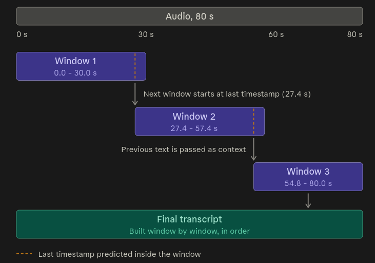
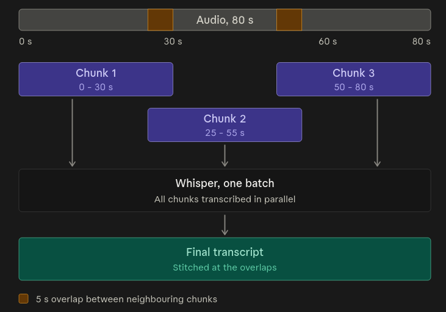

Sources: https://huggingface.co/openai/whisper-large-v3
https://arxiv.org/pdf/2212.04356

# Everything about speech to text models
Terms:
(ASR) - automatic speech recognition
(STT) - speech to text

STT models are trained on audio data and its texts. The state of the art models like whisper
were trained on millions of hours of audios. So there is no way to try train this model generally 
on our own. 
1. We don't have data frome pre-training (only OpenAI have those data)
2. We don't have gpu power to train this model
3. We don't have millions of hours of new good labeled audios.
Etc...

But, we can try to fine-tune this model in one specific domain and one specific language.
This is possible because probably there was little of this kind of data during training whisper.

We don't have exact estimates for whipser-large-v3-turbo, but for the original Whisper there are.
https://arxiv.org/pdf/2212.04356 at the end of this article we see percentages of kind 
of training data, and percentages for each language.
From the whole 680 000 hours of data training, 4278 hours of polish audio was used for training. 

From this mentioned 4278 hours, part of this could be medical stuff.

> The Whisper large-v3 model was trained on 1 million hours of weakly labeled audio
> and 4 million hours of pseudo-labeled audio collected using Whisper large-v2.
> The model was trained for 2.0 epochs over this mixture dataset.
>
> — [openai/whisper-large-v3 model card](https://huggingface.co/openai/whisper-large-v3)

### For fine-tuning we will not have this 5 million of audio data
Because of that, during training on a much smaller amount and smaller diversity of data,
we dont need this whole weights to train. The capacity of whisper we fine-tune is much larger
that our dataset. Because of that and some other reasons, we can decide to select Low Rank
Adaptation, LoRA or even QLoRA, for faster training.

### Can we remove part of whisper model structure dedicated for different task ?
Whisper model is trained for 2 tasks : transcription and translation. Both of this 
tasks uses same weights form model. (There are no heads only for one task) - so we don't
have nothing to remove. 
In some architectures of models, different heads are used for different tasks, so there is option
to get only this heads that we need. But not in this case.

# Load audio in case of creating transcription
Two approaches of load audio for split into shorter fragments, able to put to whisper.

1. Sequential
Run transcription on first 30 seconds of audio, and predict timestamp.
Then move to last predicted timestamp. Next window gets previous text as context,
so know what was earlier.
   

2. Chunked
   Audio is split for 30 seconds parts, with few seconds of overlap.
   All parts go to model independently in one batch to GPU. Transcriptions are connected
   

