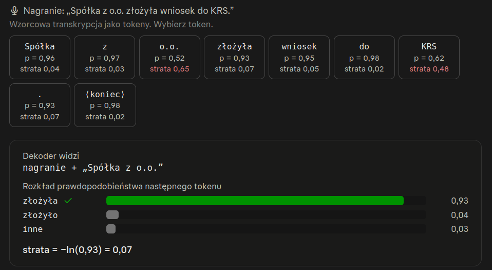
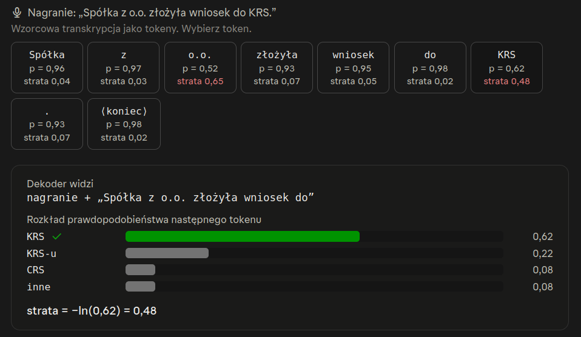

# Fine tuning of Whisper model

**Objective function:** for training Whisper can be "cross-enthropy".
For training sequence-to-sequence systems on classification tasks this is good choice.

Whisper generates transcription token-by-token. 

To predict each next token of the transcript, the decoder uses the audio recording together
with the tokens that precede it. During training these are the reference (groud-truth)
tokens, a technique called teacher forcing; at inference time, they are the tokens the
model has generated so far. The loss depends on the probability the model assigns to the
correct token: the lower that probability, the higher the loss. When whisper is uncertain
this shows in the output distribution, which spreads probability across several candidate 
tokens instead of concentrating it on one. The higher the loss on a given token, the
larger its gradient, so tokens the model predicts poorly push the weight update
harder than tokens it already predicts well.
In the example below, the model assigned a much lower probability to the correct token
than in the example above, so the loss was considerably higher.

Materials:
+ https://huggingface.co/blog/fine-tune-whisper
+ 