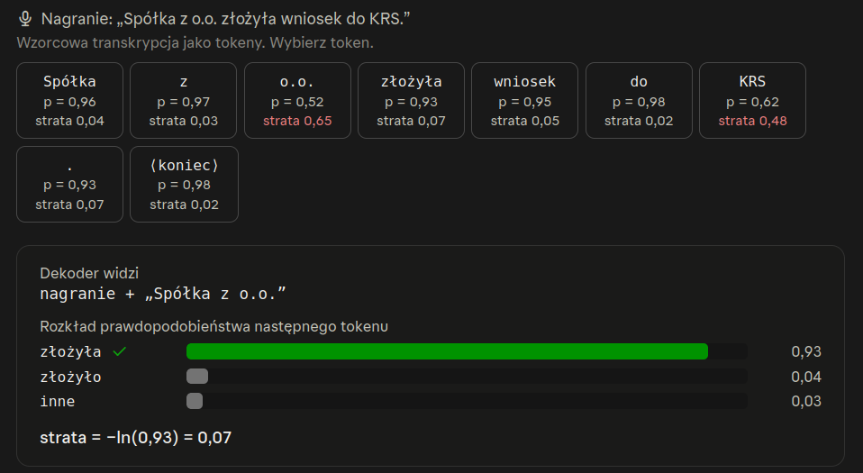
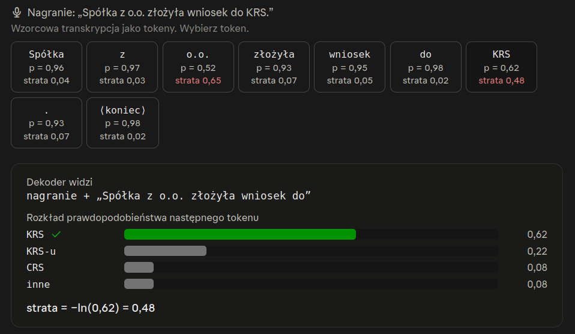
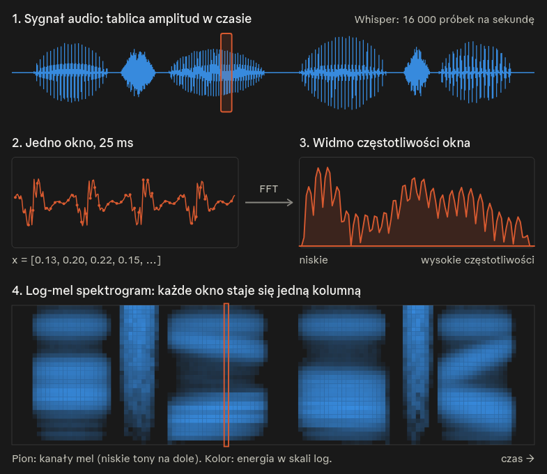
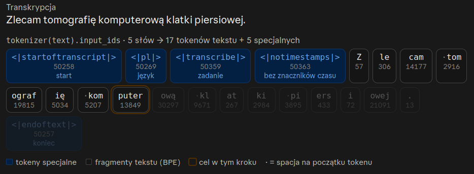
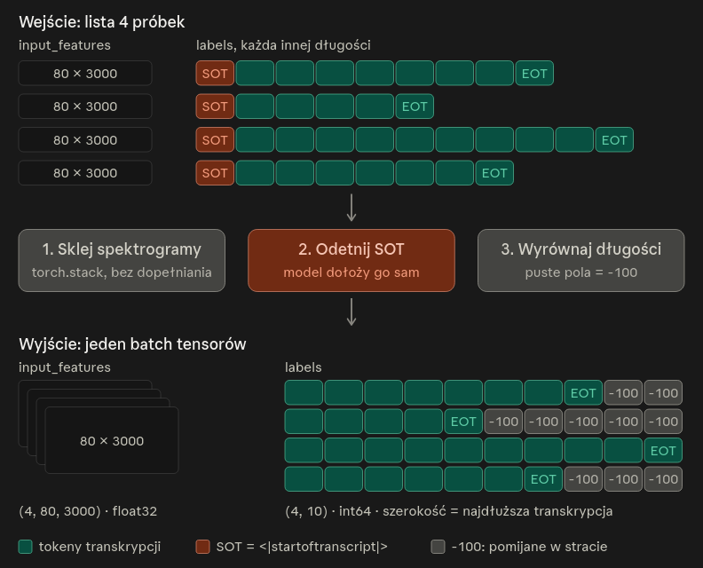

# Fine tuning of Whisper model

**Objective function:** for training Whisper can be "cross-enthropy".
For training sequence-to-sequence systems on classification tasks this is good choice.

Whisper generates transcription token-by-token. 

To predict each next token of the transcript, the decoder uses the audio recording together
with the tokens that precede it. During training these are the reference (groud-truth)
tokens, a technique called teacher forcing; at inference time, they are the tokens the
model has generated so far. The loss depends on the probability the model assigns to the
correct token: the lower that probability, the higher the loss. When whisper is uncertain
this shows in the output distribution, which spreads probability across several candidate 
tokens instead of concentrating it on one. The higher the loss on a given token, the
larger its gradient, so tokens the model predicts poorly push the weight update
harder than tokens it already predicts well.
In the example below, the model assigned a much lower probability to the correct token
than in the example above, so the loss was considerably higher.

# How do an extraction of features
Base on the frequencies, there can be extracted information about the sound.

Feature extraction from audio:
1. Table of amplitudes. We need to store audio at specified frequency. For whisper
it is 16kHz. The result of it is the one dimension table x.
2. Window. From table, we split short overlapping fragments. In whisper it is 25ms per each 10ms of audio.
3. Spectrum. Fourier Transform (FFT) - breaks the window down into frequencies.
4. Log-mel spectogram. Spectrum of each window is the next column in this spectogram.
On x-axis we have time, on y-axis next windows of audio. Color is related to 
band intensity.

**Prepared audio that we work on during fine-tuning need to have 16kHz frequency**

# Tokenize text

We want use transcription of audio during fine-tuning. For that reason we need to have
this text in numeric format. So we tokenize text into token IDs good for further calculations.

In addition to this, special tokens are also important. In below example we have 
special tokens: <|startoftranscript|>, <|pl|>, <|transcribe|>, <|notimestamps|> 
and also more popular <|endoftext|> special token.
This first four tokens are specifics for whisper, they tell what to do.

# Prepare batch for transcriptions of audios
From list of single samples, we need to create a batch of tensors, to run training
with batches.

1. Step 1: Spectograms are already in same dimensions, so we simply combine them
2. Step 2: Remove SOT special token, because model will put this token 
3. Step 3: Fill empty transcriptions (if audio is shorter, then the longest audio)

Materials:
+ https://huggingface.co/blog/fine-tune-whisper
+ 