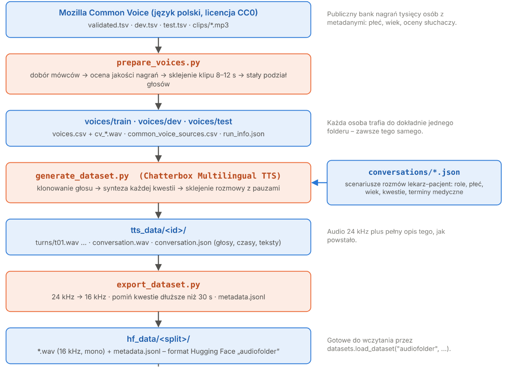

# Synthetic conversations for STT fine-tuning

The generator reads conversations from JSON files, gives every speaker a voice cloned by **Chatterbox
Multilingual** (Polish, from a ~10 s reference recording) and exports 16 kHz turns with transcripts in the
Hugging Face `audiofolder` format. The conversation format and the transcription conventions are in the
[main README](../README.md).



| Script | What it does |
|---|---|
| `prepare_voices.py` | reference voices from Common Voice PL, split into train / dev / test |
| `generate_dataset.py` | synthesizes each turn and the whole conversation |
| `export_dataset.py` | 16 kHz wav per turn and `metadata.jsonl` |

## Installation

Use a separate environment with Python 3.11. `requirements.txt` pins a Chatterbox commit from GitHub, because
the PyPI release (0.1.7) has only V2. Chatterbox also pins `torch==2.6.0`, `transformers==5.2.0` and `numpy<2`,
so keep it apart from the training environment (or save the old state first with `pip freeze`).

```bash
pip install -r requirements.txt
python -c "from chatterbox import mtl_tts; print(mtl_tts.MULTILINGUAL_T3_MODELS)"   # must contain 'v3'
```

## Quick start

```bash
# 1. Reference voices (once)
python prepare_voices.py --common-voice ~/path/cv-corpus-XX/pl --out voices/ --max-speakers 200

# 2. Dry run without a GPU
python generate_dataset.py conversations/ --voices voices/train/voices.csv --out /tmp/test --backend dummy --limit 2

# 3. Training data: generate (listen to a sample of tts_data/<id>/conversation.wav), then export
python generate_dataset.py conversations/ --voices voices/train/voices.csv --out tts_data/
python export_dataset.py tts_data/ --out hf_data/ --split train

# 4. Synthetic test: test conversations read by test voices
python generate_dataset.py ../evaluation/medical-evaluation/ --voices voices/test/voices.csv --out tts_data_test/
python export_dataset.py tts_data_test/ --out hf_data/ --split test
```

## Voices

A good reference is 8–12 s of clean Polish speech from one person, without music, reverb or noise, because the
model copies those too. `prepare_voices.py` joins several Common Voice recordings of a person, trims silence,
normalizes loudness and rejects low SNR and clipping:

```
voices/
  train/ dev/ test/          voices.csv + cv_*.wav for each set
  common_voice_sources.csv   each voice: split, client_id, recordings used
  run_info.json              command, fractions, parameters, number of voices
```

`voices.csv` has the columns `id, path, gender (K/M), age (dziecko/mlody/dorosly/senior, optional), split`.

| Conversations | `--voices` |
|---|---|
| `conversations/` (training) | `voices/train/voices.csv` |
| validation conversations, e.g. `conversations_dev/` | `voices/dev/voices.csv` |
| `../evaluation/medical-evaluation/` (test) | `voices/test/voices.csv` |

- The set depends only on a hash of the person's `client_id`, so a person always lands in the same set.
  `--dev-frac` and `--test-frac` are 0.2 each by default.
- Do not change the fractions after generating training data, because some `train` voices would move to
  `dev` / `test`. The script warns when they differ from the previous `run_info.json`. (This will be fixed)
- A rerun overwrites `voices.csv` and deletes the clips that are not in it, so remove bad voices from
  `voices.csv` after the last run.

## Generation

```bash
python generate_dataset.py conversations/ --voices voices/train/voices.csv --out tts_data/ [--only train_014] [--limit N]
```

```
tts_data/<id>/
  turns/t01.wav …      each turn, 24 kHz
  conversation.wav     the whole conversation with pauses
  conversation.json    model, voices, parameters, turn timings, text, tts_text, events
```

- Each speaker gets a different voice of the same gender, from the same age group where possible. Voices,
  Chatterbox parameters (ranges in `PARAMS` at the top of the file) and pauses depend only on the conversation
  id and `--seed`, so a rerun gives the same audio.
- `--t3-model v3` (default) or `v2`. Write the output of each model to a separate `--out` directory.
- Finished conversations are skipped, so an interrupted run can be started again (`--overwrite` regenerates).
- `forcing EOS token` warnings are not errors, but such turns may be cut off or have extra syllables appended.
  Listen to them.

## Export

```bash
python export_dataset.py tts_data/ [tts_data_extra/ …] --out hf_data/ --split train
```

Writes `hf_data/<split>/`: 16 kHz mono wav per turn and `metadata.jsonl` (`file_name`, `text`, `conversation`,
`turn`, `speaker`, `voice`, `duration`, `specialization`, `medical_terms`). Turns longer than `--max-s` (30 s,
Whisper's window) are skipped. Exporting to the same split again overwrites it.

```python
from datasets import load_dataset
ds = load_dataset("audiofolder", data_dir="hf_data")   # datasets ≥ 4 needs torchcodec and FFmpeg
```
