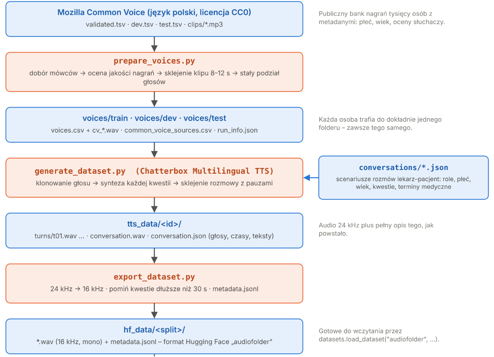

# Synthetic conversations for STT fine-tuning

The generator reads conversations from JSON files, gives every speaker a voice cloned by **Chatterbox
Multilingual** (Polish, from a ~10 s reference recording) and exports 16 kHz turns with transcripts in the
Hugging Face `audiofolder` format. The conversation format and the transcription conventions are in the
[main README](../README.md).



| Script | What it does |
|---|---|
| `prepare_voices.py` | reference voices from Common Voice PL, split into train / dev / test |
| `generate_dataset.py` | synthesizes each turn and the whole conversation |
| `export_dataset.py` | 16 kHz wav per turn and `metadata.jsonl` |

## Installation

Use a separate environment with Python 3.11. `requirements.txt` pins a Chatterbox commit from GitHub, because
the PyPI release (0.1.7) has only V2. Chatterbox also pins `torch==2.6.0`, `transformers==5.2.0` and `numpy<2`,
so keep it apart from the training environment (or save the old state first with `pip freeze`).

```bash
pip install -r requirements.txt
python -c "from chatterbox import mtl_tts; print(mtl_tts.MULTILINGUAL_T3_MODELS)"   # must contain 'v3'
```

## Quick start

Commands are run in `synthetic-data-creation/`. All data is in `../data/`; its layout is in the
[main README](../README.md#data).

```bash
# 1. Reference voices (once)
python prepare_voices.py --common-voice ~/path/cv-corpus-XX/pl --out ../data/voices/

# 2. Dry run without a GPU
python generate_dataset.py ../data/texts/train/ --voices ../data/voices/train/voices.csv --out /tmp/test \
    --backend dummy --limit 2

# 3. Training data: generate (listen to a sample of data/tts/train/<id>/conversation.wav), then export
python generate_dataset.py ../data/texts/train/ --voices ../data/voices/train/voices.csv --out ../data/tts/train/
python export_dataset.py ../data/tts/train/ --out ../data/training/ --split train

# 4. Validation data: other conversations, read by the dev voices
python generate_dataset.py ../data/texts/dev/ --voices ../data/voices/dev/voices.csv --out ../data/tts/dev/
python export_dataset.py ../data/tts/dev/ --out ../data/training/ --split validation

# 5. Synthetic test: test conversations read by test voices, built into a test set (see ../evaluation/README.md)
python generate_dataset.py ../data/eval/texts/legal-v1/ --voices ../data/voices/test/voices.csv \
    --out ../data/tts/test-chatterbox/
python ../evaluation/build_tts_set.py ../data/tts/test-chatterbox/ --name legal-chatterbox-v1 --texts legal-v1 \
    --domain legal --tts-license MIT --voices-license CC0-1.0
```

The test audio does not go through `export_dataset.py` and `data/training/`: a new export replaces the old
one, and the test must stay the same between the evaluation of the base model and of the fine-tuned one.

## Voices

A good reference is 8–12 s of clean Polish speech from one person, without music, reverb or noise, because the
model copies those too. `prepare_voices.py` joins several Common Voice recordings of a person, trims silence,
normalizes loudness and rejects low SNR and clipping:

```
data/voices/
  train/ dev/ test/          voices.csv + cv_*.wav for each set
  common_voice_sources.csv   each voice: split, client_id, Common Voice split, recordings used
  run_info.json              command, fractions, parameters, people left out by each rule, number of voices
```

`voices.csv` has the columns `id, path, gender (K/M), age (dziecko/mlody/dorosly/senior, optional), split,
gender_source, pitch_hz`.

Everyone whose recordings give a good enough clip becomes a voice (`--max-speakers N` stops after N, for a
quick try in another `--out`):

- A person's recordings come from `validated.tsv` and from `other.tsv`, which nobody has reviewed yet. At most
  12 are tried, reviewed and best rated first.
- A person needs 6 s of clean speech (`--min-s`), and 8 s (`--min-s-few-clips`) with fewer than 3 recordings
  (`--min-clips`).
- People without an age in the metadata are taken; the generator uses such a voice for a speaker of any age.
- People without a gender in the metadata are taken, with the gender read from the pitch of the clip:
  `gender_source` is then `pitch`, or `pitch-uncertain` between 150 and 180 Hz, where male and female voices
  overlap. Their id starts with `cv_x_`. Correct `gender` in `voices.csv` when you hear it is wrong.
- Left out: people who reported the age "teens" and accounts with two genders (shared by several people).
- Speakers of the Common Voice `dev.tsv` and `test.tsv` are taken too, because most speakers are there. So do
  not test the model on Common Voice recordings: their speakers are in the voice pools, also in the training
  one. `--exclude-cv-splits dev test` leaves these people out.

The script ends with the voices to listen to first: an uncertain gender, a pitch that does not fit the gender
in the metadata, no pitch at all.

The three pools stay in one folder: `prepare_voices.py` writes them together, and `check_set.py --voices`
reads the whole folder. The clips of `dev` and `test` are not test data, only the voices the validation and
test conversations are read with.

| Conversations | `--voices` | `--out` |
|---|---|---|
| `data/texts/train/` (training) | `data/voices/train/voices.csv` | `data/tts/train/` |
| `data/texts/dev/` (validation) | `data/voices/dev/voices.csv` | `data/tts/dev/` |
| `data/eval/texts/legal-v1/` (test) | `data/voices/test/voices.csv` | `data/tts/test-chatterbox/` |

- The set depends only on a hash of the person's `client_id`, so a person always lands in the same set.
  `--dev-frac` and `--test-frac` are 0.2 each by default.
- Do not change the fractions after generating training data, because some `train` voices would move to
  `dev` / `test`. The script warns when they differ from the previous `run_info.json`. (This will be fixed)
- A rerun overwrites `voices.csv` and deletes the clips that are not in it, so remove bad voices from
  `voices.csv` after the last run.

## Generation

```bash
python generate_dataset.py ../data/texts/train/ --voices ../data/voices/train/voices.csv --out ../data/tts/train/ \
    [--only train_014] [--limit N]
```

```
data/tts/train/<id>/
  turns/t01.wav …      each turn, 24 kHz
  conversation.wav     the whole conversation with pauses
  conversation.json    model, voices, parameters, turn timings, text, tts_text, events
```

- Each speaker gets a different voice of the same gender, from the same age group where possible. Voices,
  Chatterbox parameters (ranges in `PARAMS` at the top of the file) and pauses depend only on the conversation
  id and `--seed`, so a rerun gives the same audio.
- `--t3-model v3` (default) or `v2`. Write the output of each model to a separate `--out` directory.
- Finished conversations are skipped, so an interrupted run can be started again (`--overwrite` regenerates).
- `forcing EOS token` warnings are not errors, but such turns may be cut off or have extra syllables appended.
  Listen to them.

## Export

```bash
python export_dataset.py ../data/tts/train/ [../data/tts/train-extra/ …] --out ../data/training/ --split train
python export_dataset.py ../data/tts/dev/ --out ../data/training/ --split validation
```

One run writes one split, `data/training/<split>/`: 16 kHz mono wav per turn and `metadata.jsonl` (`file_name`,
`text`, `conversation`, `turn`, `speaker`, `voice`, `duration`, `subdomain`, `terms`). Turns longer
than `--max-s` (30 s, Whisper's window) are skipped. Exporting to the same split again overwrites it.

```python
from datasets import load_dataset
ds = load_dataset("audiofolder", data_dir="../data/training")   # datasets ≥ 4 needs torchcodec and FFmpeg
```
